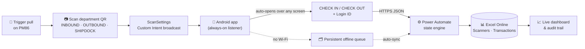
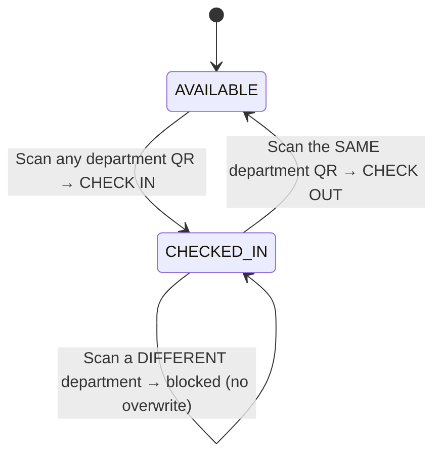

# 📦 Scanner — Check-In / Check-Out for Warehouse

### Scan once. Know where every handheld scanner is, who has it, and since when.

**One trigger pull → one QR code → one Login ID → a live, audit-ready record in Excel.**

 

---

## 🧭 Overview

Warehouses run on handheld scanners, and these devices tend to go missing. They get left on a pallet, taken to another
department, or picked up at the end of a shift without anyone signing for them. Paper sign-out sheets don't get filled in, and
nobody can say who had scanner #47 last Tuesday.

**Scanner Check-In/Out** puts the record on the scanner itself. An associate pulls the trigger on the device they are
about to use and scans their department's QR code. The app opens from any screen, works out whether this is a
**CHECK IN** or a **CHECK OUT**, asks for a Login ID, and writes the transaction to a central Excel workbook through
Microsoft Power Automate.

There is no app to open, no form to find and no clipboard on the wall. The whole interaction takes about five seconds.

Built for **Point Mobile PM86** rugged Android scanners, using the scanner's native ScanSettings intent output (no
vendor SDK required).

---

## ✨ Why it matters on the warehouse floor

<table>
<tr>
<td width="50%" valign="top">

### 🔍 Full accountability
Every check-in and check-out is tied to a **person**, a **department**, a **device serial number**, a
**company asset tag** and an exact **date and time**. "Who had it last?" is answered in seconds.

### 📍 Live device location
A dashboard shows how many scanners are currently checked in to each department and which ones are free.
Shift leads can see where the equipment is before a shift starts.

### 💸 Fewer lost devices
Rugged scanners cost a lot to replace. When every device has a named owner at all times, they stop disappearing.

</td>
<td width="50%" valign="top">

### 🧾 Audit-ready by design
One immutable row per check-in, closed by its matching check-out, with **no duplicates and no overwritten history**.
Records can be handed straight to an internal audit, a loss-prevention review or an asset reconciliation.

### ⚡ Zero friction for associates
A trigger pull, a scan and a Login ID. No training session, no extra app to remember, and it works from the home screen
or from inside any other app.

### 🛡️ Built to fail safe
Wi-Fi drops, reboots, held triggers, double scans and wrong-department scans are all handled. A transaction is
never silently lost or counted twice.

</td>
</tr>
</table>

---

## 🧾 Audit & compliance value

| Audit question | Answered by |
|---|---|
| Who used device **X** on a given day? | Transactions history: User Name + Check In/Out Date & Time |
| Which devices are out **right now**, and with whom? | Live `Current Status` / `Current User` on the Scanners register |
| Which devices were **never returned** at end of shift? | Dashboard: *Still open from previous days* |
| Does the **asset register** match the physical fleet? | Serial Number ⇄ Asset Tag master list, one row per device |
| Can a record be **duplicated or overwritten**? | No. Each transaction carries a unique ID; check-out closes only its own open record |
| Can an associate **change device identity**? | No. Serial and Asset Tag are locked behind a PIN-protected IT/Admin mode |
| What happened while the network was **down**? | Offline transactions are queued in order, flagged `Offline = True`, and synced automatically |

---

## 🏗️ Architecture

### How the decision is made
The central workbook is the **single source of truth**. On every scan the app asks the flow for the scanner's current
state, and the flow re-validates that state before writing anything.

---

## 🔑 Key features

- **Hands-free launch.** The app opens itself from any screen the moment a valid QR code is scanned
- **Automatic CHECK IN / CHECK OUT.** The same QR code is used for both directions, and the system decides based on live central state
- **Device identity.** The hardware serial number is detected automatically and permanently paired with a 6-digit company Asset Tag
- **Wrong-department protection.** A scanner checked in to one department can't be closed or overwritten from another
- **Duplicate-scan protection.** Debounce for held triggers, plus a post-save cooldown and idempotent transaction IDs
- **Offline-first.** A persistent, ordered retry queue survives reboots and power loss
- **IT/Admin mode.** PIN-protected (PBKDF2, with lockout) for Asset Tag registration, configuration and diagnostics
- **Fleet tooling.** Windows scripts register and provision 40+ devices over ADB in about a minute each
- **Self-documenting data.** The Excel workbook includes a live Dashboard and a built-in Read Me sheet

---

## 📊 Data model

<table>
<tr>
<td valign="top">

**`tblScanners`**: one row per physical device
| Column | Purpose |
|---|---|
| Serial Number | Hardware identity (key) |
| Asset Tag | 6-digit company tag |
| Registration Status | ACTIVE / RETIRED |
| Current Status | CHECKED IN / AVAILABLE |
| Current Department / User | Who has it, and where |
| Open Record ID | Links to the open transaction |
| Last Transaction ID | Idempotency guard |

</td>
<td valign="top">

**`tblTransactions`**: one row per check-in, closed by its check-out
| Column | Purpose |
|---|---|
| Record ID | Unique transaction ID (key) |
| Serial Number / Asset Tag | Which device |
| Department | INBOUND · OUTBOUND · SHIPDOCK |
| User Name | Who checked it in |
| Check In Date / Time | When it went out |
| Check Out Date / Time / User | When and by whom it came back |
| Offline · App Version · Last Updated | Traceability |

</td>
</tr>
</table>

---

## 🧰 Tech stack

| Layer | Technology |
|---|---|
| Device | Point Mobile PM86 · Android 11 · ScanSettings *Custom Intent* |
| App | Kotlin · Android framework only (**no third-party libraries**) · foreground listener service · boot-persistent |
| Integration | Microsoft Power Automate (HTTP-triggered cloud flow, single decision engine, structured JSON responses) |
| Storage | Excel Online (Business) structured tables with a live dashboard |
| Fleet ops | ADB-based provisioning (PowerShell + batch) and a DUMP-permission-protected provisioning receiver |

---

## 🔐 Security & reliability highlights

- The flow endpoint is never shown in the associate UI, and the admin view masks it
- The provisioning receiver only accepts commands from a connected IT workstation (ADB), never from other apps
- Admin PIN is salted and hashed, with lockout after repeated failures
- Every write is validated server-side: state, department, duplicate transaction and registration
- Time is always recorded in the warehouse time zone, whatever the device clock is set to

---

## 🗺️ Roadmap

- [ ] Additional departments (e.g. ICQA) and site-level multi-warehouse support
- [ ] Power BI utilization report: device hours per department and per shift
- [ ] End-of-shift alert for devices still checked out
- [ ] Badge-scan login (scan the associate's badge instead of typing a Login ID)
- [ ] MDM/EMM-managed configuration for zero-touch fleet rollout

---

### 👤 Author

**Dish Dudhat** · IT Specialist  
Building practical automation for real warehouse operations.

Released under the MIT License.

